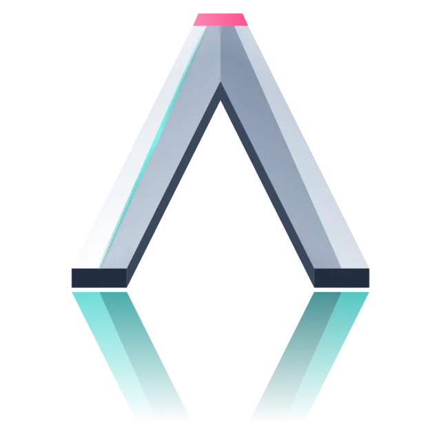
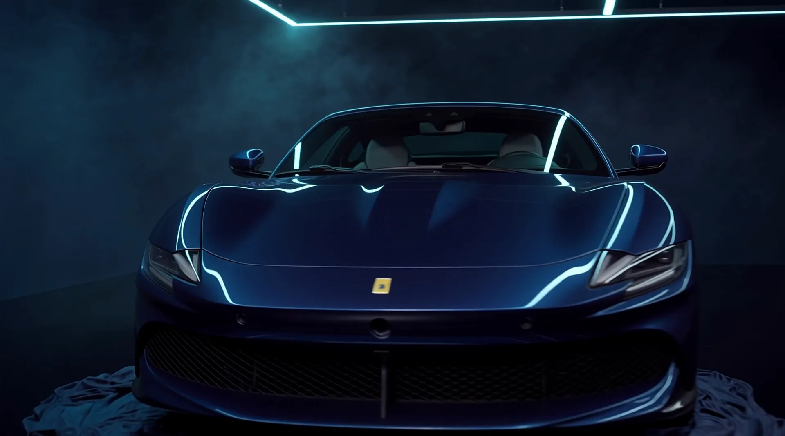
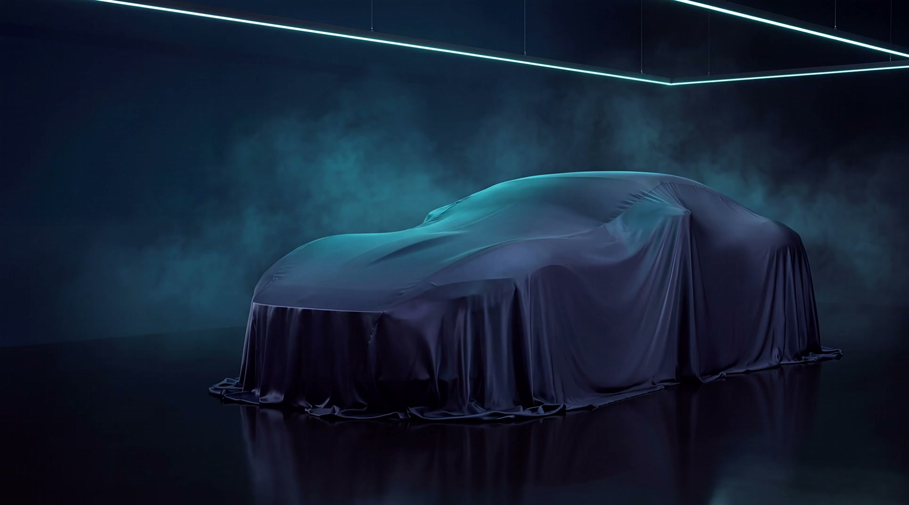

# Aureus Detailing website: build spec V4, "The Reveal"

Written 17 Nov 2026. Replaces BUILD-PROMPT-V3.md. Site folder: `/Users/mdarfanuzzaman/Documents/Monsoor Motors/Aureus Detailing/07 Website`, served at `http://localhost:4173` (already running, do not start a server).

One-line concept: a pinned studio stage. A navy silk cover glides off a navy blue Ferrari Roma on its own, a glass HUD slides in from all four edges, then the visitor's scroll orbits the camera along the paint to the rear wheel. Everything below the film is short, dense and built from hairlines and glass.

## 0. Facts checked on disk before writing (build against these)

| Item | Finding |
|---|---|
| `assets/film/aureus-film.mp4` | New Ferrari film is in place. 1928x1072, 24 fps, 361 frames, 15.04 s, 11.7 MB, GOP 8, no audio. |
| `assets/film/aureus-film-mobile.mp4` | Same film, 1294x720, 4.7 MB, GOP 4. |
| Film timeline | 0.0-2.0 s covered car, slow push. 2.0-4.5 s cover slides forward off the car while the camera moves to the front. **4.75 s cover is clear.** 4.9-6.0 s front dead-on, car centred, spans about 17-93% of frame width. 6.0-7.0 s front-left corner and headlight. 7.0-9.5 s travel along the flank (mirror, door, aqua light lines running over the paint). 9.5-11.0 s rear haunch and wheel, tail light enters, camera pulls back. 12.0-15.0 s hold on rear three-quarter: wheel and haunch on the right, dark fog on the left 36% of frame. |
| Last frame landmarks (fractions of the film frame) | Water beads on the haunch: x 0.634, y 0.242. Rear wheel hub: x 0.670, y 0.669. Tail light: x 0.434, y 0.341. |
| `assets/film/aureus-film-poster.jpg` | **Stale: still shows the old SUV** (1920x1080). Must be regenerated from film frame 0 (step 7.2). |
| `storyboard/ferrari/hero.png`, `start.png`, `end.png` | 5504x3072. They are WebP data with a `.png` name; PIL and ffmpeg read them, `cwebp` is installed, this ffmpeg build has **no libwebp encoder and no drawtext**. Use PIL to write WebP. |
| Local server | Python `http.server`: no HTTP Range support. The film must be fetched to a Blob before seeking (as `scrub.js` does today). |
| Current page length | 8240 px at 1440x900 = 9.2 screens (hero 3204, packages 1119, booking 1416, workshop 856, quote 622, FAQ 628, footer 395). V4 target is 6.9. |
| Fonts | `CormorantGaramond-latin.woff2` is variable, wght 300-700 (v3 only declared 500-700). `Montserrat-Variable-latin.ttf` is wght 100-900. No italics, no mono face. |
| Vendor versions on npm today | `gsap@3.15.1` (`dist/gsap.min.js` 73 kB, `dist/ScrollTrigger.min.js` 45 kB), `lenis@1.3.27` (`dist/lenis.min.js` 19 kB, UMD, global `Lenis`). |
| `app.js` contract | It renders into `#dock-veh`, `#dock-pack`, `#veh-seg`, `#packs` and listens on `document` for `change` and `click`. Selecting a package from outside is done by checking `input[name="pack-dock"][value=ID]` and dispatching a bubbling `change` event. It sets `.pack[data-selected]`, `#nav[data-open]`, `.nav-links a[aria-current]`, `#bar[data-hide]`. `wash()` and `work()` return early when `#wash` and `#work-video` are absent. |

## 1. Reference-to-site mapping

Primary model for the whole experience: **Octaboot**. Primary model for the hero stage: **the Ferrari page in the Marcelo Cedeno reel**.

### 1.1 Octaboot, 3D scroll car wash site (primary)

| Copied | Where on Aureus |
|---|---|
| Pinned full-viewport stage, pre-rendered footage scrubbed 1:1 by scroll, linear, fully reversible | Hero `#hero`: sticky 100svh stage, film time mapped linearly to scroll (S01) |
| Baked camera move reads as "the car rotates with scroll" | Film 4.9-15.0 s: front, flank, rear three-quarter, about 150 degrees |
| Text beats directly on footage, alternating left / right / left, crossfading in place with a short overlap, opacity only | Beats 01 (left), 02 (right, right-aligned), 03 (left). Windows in section 3.2 |
| Beat anatomy: accent caps eyebrow "PHASE 0X - NAME", two-line light headline, short body, two mini stats (value over caps label) | `.beat` component, section 5.3 |
| Accent word that changes colour the moment scroll leaves 0 ("ruined." to gold) | "perfected." goes ice to aqua glow (S02) |
| Bottom progress: two-digit beat counter plus a thin accent line that lengthens with scroll | Chapter dock: counter 01/02/03 plus aqua stroke filling along the curve (S03) |
| "- SCROLL" cue bottom-left at rest | `.scroll-cue` bottom-left of the stage |
| Pin releases and the frame scrolls away normally, followed by a 4-column stats strip between hairlines | Facts strip at the top of `#packages` (four real facts, no invented stats) |
| "Six ways in. One way out." hairline-only bento grid, numbered cards 01.., price and caps meta pinned low, one accent help card "Not sure which one? Talk to us" | Packages bento: three package cards 01-03 joined by hairlines plus a full-width help row |
| Card hover: lighter fill plus 1 px accent line on the top edge of that card only | `.pack` hover and selected state: aqua light line on the top edge (V05) |
| Featured tier title in the accent colour | Selected package title turns aqua glow |
| Full-bleed closing scene with a short left-aligned headline and two boxed buttons each with a caps sub-label | `.closing`: "Now picture yours." plus "Book a detail" and "Call 0434 13 73 93" boxed buttons |
| Headlight beams ramp on as the closing scene arrives | Exposure ramp and scale settle on the closing still (V15); see section 6 |
| Faint white dust specks over the dark sections | Static speck texture on section backgrounds (V17) |
| Fixed nav that never hides; standard system cursor; no section reveal gimmicks | Nav is always present (it compacts, it never disappears); system cursor kept; no custom cursor |

Not copied: mud, pressure-washer jet, water curtain (no such footage; owner banned foam and rinse); six beats over 5-6 screens (owner's short-scroll rule); review and cars-detailed stats (not verified).

### 1.2 Marcelo Cedeno reel

| Site in reel | Copied | Where on Aureus |
|---|---|---|
| Ferrari | Car-cover reveal intro with no UI in the way | Load intro: film 0-4.9 s plays by itself (M02) |
| Ferrari | HUD enters from all four edges, staggered, as the cover clears | M03: nav tiles from top, copy from left, glass cards from right, chapter dock from bottom |
| Ferrari | Single pinned stage, fogged dark studio, UI layered above the car | `.stage` plus `.hud` |
| Ferrari | Top nav as separate glass tiles with a glowing active tile; logo tile top-left; chip top-right | Nav state A: chrome logo tile, four tiles (Packages, Booking, Workshop, Questions), "Open seven days / 0434 13 73 93" chip, pink Book pill |
| Ferrari | Right column of glass spec cards incl. a circular glowing ring gauge ("Range 320 km/h") | `.hud-right`: Instant price tile (the booking dock with a three-arc ring around the live price) and Mobile range tile (ring reading "20 km") |
| Ferrari | Vertical pill stack with one green active pill | Vehicle picker inside the dock (`#dock-veh`) as a vertical pill stack, aqua active pill |
| Ferrari | Bottom icon dock cradled in a thin curved line over a fade to black | Chapter dock: three chapter buttons on the same swooping curve; the curve is also the progress line |
| Ferrari | Camera orbit from front to rear wheel with the HUD fixed | S01. Deviation: the right cards and nav tiles retract during the orbit so beat copy can sit on the footage the Octaboot way (S04) |
| Ferrari | Hotspot dot on the wheel hub with a leader line and label "Ultra-strong" | Two hotspots on the final hold: water beads "Hydrophobic ceramic shield", wheel hub "Wheel and rim deep clean" (S07) |
| liiv | Floating glass nav with pill CTA; "Scroll Down" cue | Glass tiles and pink Book pill; scroll cue |
| Real estate | Fixed nav that adapts when a new panel covers the hero; two-tone headline with one accent word | Nav compacts past the hero rest state; "perfected." accent |
| Saratoga | Wide-tracked caps text links; small autoplay lifestyle video thumbnail in a rounded tile | Caps label style; team reel tile in the workshop row |
| Vibram / Neuron | Nothing structural (3D boots, shatter). Giant single word scale informs the H1 size | H1 at 9.4vw |

Not copied: user avatar chip, music/climate icons, globe, top-down wireframe, exploded wheel (see section 6).

### 1.3 Vison Studios, six trends

| Clip | Copied | Where on Aureus |
|---|---|---|
| 01 Floating navigation | Inline nav leaves, a round dark menu disc scales in top-right (0 to 1 in 0.3 s) and stays over every section | Nav state B: tiles leave, 48 px glass disc pops in beside the Book pill (N01) |
| 01 | Line-by-line masked text reveal on section entry | All section H2s (V02) |
| 01 | Section edge that is a deep curve and flattens on scroll, revealing a darker footer underneath that moves slower | Bottom edge of the info section over the closing scene (V14) |
| 01 | Hairline-divided rows; outlined pills | FAQ rows; tag pills in the workshop card |
| 02 Scroll storytelling (Apple) | Chapters of eyebrow, big headline, paragraph, each with its own media moment; pinned scrubbed sequence with text blocks swapping sides | The three beats |
| 02 | Hero lockup bottom-left, price and Buy pill on the right | Beat 01 lockup bottom-left; live price and "Book this" in the right tile |
| 02 | Text darkens from ghost to ink and rises, tied to scroll; per-line stagger | Beat entry: opacity plus 12 px rise, lines offset by 0.015 of progress |
| 02 | Stat pair under thin top rules | Beat mini stats and facts strip |
| 02 | One open at a time (chips) | FAQ uses exclusive `<details name="faq">`; mobile package accordion is single-open |
| 02 | Carousel dot pill with a separate play/pause button | Team reel: four progress ticks plus a pause button |
| 03 Interactive cards (Cuberto) | Cards that open one after another on scroll, three-step transition: fill cross-fade, growth, content fade; index numbers 01.. | Package cards open in sequence when the bento enters (V04); on phones a real expanding accordion (V08) |
| 03 | Masked line reveals for headlines; staggered tile fade-in | V02, V03, V12 |
| 03 | Rounded media with inner parallax inside its mask | Closing still (V15) |
| 04 Big hero type (Exo Ape) | Oversized light-weight display headline over a full-bleed moving image; tight leading | H1 "Detailing, / perfected." Cormorant 500 at 9.4vw, line-height 0.86 |
| 04 | Two-state fixed nav (full, then compact) | Nav A and B |
| 04 | Smooth inertial scroll | Lenis on desktop pointers |
| 04 | Background moving slower than the page as the hero leaves; hard-edged section changes; small star-bullet labels; underlined text CTAs | S11 stage departure; hairline section edges; `.label` eyebrows with a 6 px aqua tick; "Get a quote" text link |
| 05 3D product view (ORYZO) | One object kept as the hero through every chapter while its angle changes with scroll; text chapters fading around it; frosted info cards; "SCROLL TO CONTINUE" hint | The car through the film; beats; glass tiles; scroll cue |
| 05 | Dotted viewfinder frame motif | Hotspot leader lines end in 5 px ticks |
| 06 Motion cues (OBYS) | One logo-derived motif reused as loader, selector and state signal; open = browsing, closed = busy | The **light line** (the studio's aqua ceiling strip): load progress, scroll progress, active tile, hovered/selected card, section dividers, hotspot leaders. HUD extended = at rest, HUD retracted = film in motion |
| 06 | Stroke-draw then fill preloader; inactive items grey, active item in colour; tiny uniform UI type against one oversized element | Light-line loader (M01); unselected packages dimmer; 11-12 px labels against the 9.4vw H1 |

Not copied from 01-06 because the owner ruled out toys and manual interaction, or because there is no content for them: custom cursor badges, cursor-following preview card, hover-swap media, page-wipe transitions, case-study pages, marquee name, thumbnail film-strip, foil-tear physics, horizontal carousel.

## 2. Page structure and scroll budget

Viewport unit is `svh`. Budget at 1440x900.

| # | Section (id) | Content | Height | Screens |
|---|---|---|---|---|
| 1 | Hero stage (`#hero`) | Sticky stage, film, HUD, 3 beats | 260svh (stage pinned for 160svh) | 2.60 |
| 2 | Packages (`#packages`) | Facts strip, heading with vehicle switch, 3-card bento, help row | about 1035 px | 1.15 |
| 3 | Booking (`#booking`) | Existing form, three columns | about 1035 px | 1.15 |
| 4 | Info (`#workshop`, `#faq`, `#quote`) | Row A: workshop card, map, team reel. Row B: questions, quote form | about 1080 px | 1.20 |
| 5 | Closing and footer | Closing scene with 3D logo and two boxed buttons, footer columns, disclaimer | about 720 px | 0.80 |
| | **Total** | | about 6210 px | **6.90** |

Hard limits (acceptance): hero `offsetHeight / innerHeight <= 2.6`; `document.documentElement.scrollHeight / innerHeight <= 7.2` at 1440x900 and at 1920x1080. Phone (375x812): hero 240svh; whole page at most 11 screens.

Order in `<main>`: `span#top`, `section#hero`, `section#packages`, `section#booking`, `section.info`, `section.closing`. Then `footer.foot`, `#bar`, `#toast`.

Static mode (reduced motion, Save-Data, no JS, or film failure): hero is one unpinned 100svh screen on the rest still with beat 01 and the HUD; beats 02 and 03 become two side-by-side chapter cards (still image plus copy) directly under it, about 0.45 screen. Page is about 5.3 screens.

## 3. Motion script

Conventions. `p` = scroll progress through the hero pin, 0 at top, 1 when the stage releases. Film time `t = 4.9 + p * 10.09`. Eases: `out` = cubic-bezier(.16,1,.3,1); `inout` = cubic-bezier(.65,0,.35,1); `in` = cubic-bezier(.5,0,.75,0); `pop` = cubic-bezier(.34,1.3,.64,1). Scrubbed tweens use `ease: "none"`. Only `transform`, `opacity`, `clip-path`, `stroke-dashoffset` and `filter: brightness` on one element are animated. "RM" = reduced-motion behaviour.

### 3.1 Load (time-based)

| ID | Element | Trigger | Animation | Duration, ease | RM |
|---|---|---|---|---|---|
| M01 | Light-line loader (the chapter dock's line, drawn straight) | First paint | Aqua fill `scaleX` 0 to 1 following film bytes received (ReadableStream). If no Content-Length: opacity pulse 0.4 to 1 | Linear with bytes; pulse 1.2 s inout loop | Not shown |
| M02 | Film | Blob ready, `scrollY < 8`, first visit this session | `video.play()` from 0 at `playbackRate 1.75`; stop and pause at 4.9 s | 2.8 s, footage pacing | Film never fetched; rest still shown |
| M03a | Nav tiles and call chip (logo tile and Book pill are visible from first paint) | Film time >= 3.4 s, or 2.6 s after DOMContentLoaded, or first scroll, whichever is first | `y -28px to 0`, opacity 0 to 1, stagger 50 ms left to right | 500 ms out | Visible, no motion |
| M03b | Beat 01: eyebrow, then H1 lines (each line in an overflow-hidden wrapper), then body, buttons, facts | Same trigger | Eyebrow opacity 0 to 1 (300 ms). H1 lines `yPercent 110 to 0`, stagger 90 ms. Body, buttons, facts `x -24px to 0` and opacity, stagger 70 ms, delay 250 ms | H1 900 ms out; rest 600 ms out | Visible |
| M03c | Right tiles (dock, range) | Same trigger, delay 150 ms | `x 40px to 0`, opacity 0 to 1, stagger 90 ms | 600 ms out | Visible |
| M03d | Chapter dock | Same trigger, delay 300 ms | `y 32px to 0`, opacity; the straight loader line sags into the cockpit curve (tween one `sag` number 0 to 1 and rebuild the path `d`) | 700 ms inout | Curve drawn, static |
| M03e | Scroll cue and "Skip the film" | After M03d | Opacity 0 to 1 | 400 ms out | Visible |
| M04 | Scroll cue dash | Idle at `scrollY = 0` | `scaleX 0.4 to 1 to 0.4`, origin left; stops for good after the first scroll | 2.4 s inout loop | Static |
| M05 | Repeat visit in the same session (`sessionStorage["aureus-intro"]`) | Load | No M02. Rest still shown, video seeks to 4.9 s behind it, HUD fades in together | 300 ms out | Same as RM |
| M06 | Interrupt | Any wheel, touchmove, scroll key or `scrollY >= 8` during M02 | Pause the video, switch to scrub mode; the scrub smoothing carries the film forward to the scroll target. Tab hidden during M02: jump to 4.9 s | Immediate | n/a |

### 3.2 Hero scroll (scrubbed against `p`, one GSAP timeline of duration 1, `scrub: 0.5`; the film uses its own smoothing)

| ID | Element | p window | Animation | RM |
|---|---|---|---|---|
| S01 | Film | 0 to 1 | Target time `4.9 + p*10.09`. Each frame: `cur += (target - cur) * (1 - exp(-dt/0.09))`; seek when the video is not already seeking and the gap exceeds 1/60 s | Still image |
| S02 | "perfected." | `scrollY > 4` (toggle, not scrub) | Colour `#F5F8FC` to `#5FF0E6`, text-shadow `0 0 32px rgba(95,240,230,.35)`; 400 ms out; returns at the top | Stays ice |
| S03 | Chapter dock | 0 to 1 | Aqua stroke `stroke-dashoffset` 1 to 0 (pathLength 1). Counter and active chapter switch to 02 at p 0.20 and 03 at p 0.62: old digit `yPercent 0 to -100`, new `100 to 0`, 300 ms out (time-based) | Not shown |
| S04 | HUD retract | 0.04 to 0.16 | Right tiles `xPercent 0 to 120` and opacity to 0, second tile offset 0.02. Scroll cue opacity to 0 by 0.02. Beat 01 opacity 1 to 0 over 0.06 to 0.14 (no slide) | n/a |
| N01 | Nav compact (toggle at p >= 0.10, reversed below it; on phones always compact) | toggle | Tiles and call chip: opacity to 0, `y -12px`, stagger 40 ms, 220 ms in. Then menu disc `scale 0.4 to 1`, opacity 0 to 1, 300 ms pop. Logo tile cross-fades from horizontal logo to the chrome A mark, 240 ms. Reverse: disc out 180 ms in, tiles in 320 ms out | State changes with no transition |
| S05 | Beat 02 (right) | in 0.20 to 0.28, out 0.50 to 0.58 | Opacity 0 to 1 with `y 12px to 0`, each line offset 0.015; mini-stat rules `scaleX 0 to 1`. Out: opacity only | Shown as a chapter card |
| S06 | Beat 03 (left) | in 0.62 to 0.70, holds to 1 | Same as S05 in | Shown as a chapter card |
| S07 | Hotspots | A (beads): dot 0.72-0.75, leader 0.74-0.80, label 0.78-0.83. B (wheel): dot 0.80-0.83, leader 0.82-0.88, label 0.86-0.91 | Dot `scale 0 to 1`; leader `scaleX 0 to 1` from the dot; label opacity and `x 8px to 0`. While visible the dot has a ring pulse `scale 1 to 2.4`, opacity 0.5 to 0, 2.2 s out loop (CSS) | Hidden; the two labels appear as tags in the beat 03 card |
| S08 | Beat 03 buttons | 0.88 to 0.94 | Opacity 0 to 1, `y 12px to 0` | Visible |
| S09 | Scrims | Left: 1 until 0.10, to 0 by 0.18, back to 1 over 0.60-0.70. Right: 0, to 1 over 0.18-0.28, to 0 over 0.50-0.60 | Opacity | Left scrim on |
| S10 | Phone only: film framing | 0.55 to 0.75 | `object-position` x 50% to 80% (set a CSS variable) so the wheel and tail light stay in the cropped panel | n/a |
| S11 | Stage departure | Hero bottom from viewport bottom to viewport top | Media wrapper `yPercent 0 to 10`, `filter: brightness(1 to .6)` | None |

Chapter buttons scroll to p 0 (Reveal), 0.38 (Polish), 0.92 (Protect). Focus moving into a beat (`focusin`) scrolls to that beat's p so focused controls are always visible.

### 3.3 Sections (play once when they enter; triggers use ScrollTrigger `once: true`)

| ID | Element | Trigger | Animation | Duration, ease | RM |
|---|---|---|---|---|---|
| V01 | `.lightline` section dividers | Top < 85% of viewport | `scaleX 0 to 1`, origin left | 900 ms out | Drawn |
| V02 | Section H2 lines, lede | Top < 80% | Lines `yPercent 105 to 0`, stagger 80 ms; lede opacity and `y 12px`, delay 150 ms | 800 ms out; 600 ms out | Visible |
| V03 | Facts strip | Top < 85% | Values `yPercent 100 to 0` in masks, stagger 70 ms; labels opacity, delay 200 ms | 700 ms out | Visible |
| V04 | Package cards open in order 01, 02, 03 | Bento top < 75% | Per card, 140 ms apart: fill `rgba(206,224,245,.03) to .07` (300 ms), list, extras and button `clip-path inset(0 0 100% 0) to inset(0)` (700 ms out) with opacity 0 to 1 in the first 300 ms, price rises in its mask (500 ms out). Then the selected card's top light line draws (500 ms out). Help row fades 400 ms | as listed | All open |
| V05 | Package card hover (fine pointers) and selected | Hover / `data-selected` | Fill plus 0.04; top light line `scaleX 0 to 1`; title to aqua glow when selected. Press: `scale .995` | In 240 ms out, out 180 ms in | Colour only |
| V06 | Card prices, dock price, booking total | Text changes (MutationObserver on `[data-card-price]`, `#dock-price`, `#sum-total`) | New value from `y 40%`, opacity 0, blur 2 px when the price rose (from `-40%` when it fell) | 320 ms out | Instant |
| V07 | Dock ring arcs | Package changes | Arcs up to the chosen tier `stroke-opacity .2 to 1` | 240 ms out | Instant |
| V08 | Phone package accordion | `data-selected` changes | Opening: fill cross-fade 200 ms, body `grid-template-rows 0fr to 1fr` 420 ms inout, content opacity 0 to 1 240 ms after 120 ms. Closing 280 ms in | as listed | Instant |
| V09 | Extras list (`hidden` toggled by app.js) | Unhidden | `@starting-style`: opacity 0, `translateY 6px` | 240 ms out | Instant |
| V10 | Booking confirmation | `#bk-done` unhidden | Panel opacity and `y 16px`; crystal tick ring 1 s then tick 0.7 s after 0.55 s (existing keyframes) | 500 ms out | Tick drawn |
| V11 | Team reel | In view >= 50% | Active clip plays; on `ended` cross-fade to the next (400 ms), tick fills linearly over the clip; pauses off-screen | as listed | No autoplay; posters plus a Play button |
| V12 | Info cells | Row top < 85% | Opacity and `y 24px to 0`, stagger 80 ms | 600 ms out | Visible |
| V13 | FAQ open/close | `<details>` toggle | `::details-content` height with `interpolate-size: allow-keywords` where supported; plus icon rotates 45 degrees | 320 ms inout | Instant |
| V14 | Curved edge | Closing top from viewport bottom to 55% | Info section bottom radius `--sag` 72 px to 0 (scrub) | scrub | Flat |
| V15 | Closing still | Closing top from viewport bottom to 30% | `scale 1.10 to 1`, `brightness .55 to 1` (scrub); inner parallax `yPercent -6 to 6` across the section; headline lines as V02 at 35% in view; boxed buttons opacity and `y 16px`, stagger 100 ms, 600 ms out | scrub / as listed | Final state |
| V16 | 3D logo | Closing in view | `rotateY -18deg to 18deg`, `rotateX 6deg to -4deg` (scrub); one specular sweep on entry (1.6 s inout); then idle sway +-3 degrees | 8 s inout loop | Static at rotateY -8deg |
| V17 | Speck texture | none | Static CSS background with `background-attachment: fixed` on desktop | n/a | Same |
| V18 | Menu panel (compact nav, `#nav[data-open="true"]`) | Toggle | `clip-path inset(0 0 100% 0 round 22px) to inset(0 round 22px)`, rows opacity and `y 8px`, stagger 35 ms; close 200 ms in | 380 ms out | Instant |
| V19 | Buttons | Hover / active | Hover `translateY(-2px)` 160 ms out; active `scale(.98)` 80 ms | as listed | Colour only |

Global RM rules: no Lenis, no ScrollTrigger timelines, no film fetch, no autoplaying video, no loops; opacity and colour transitions of 200 ms or less are allowed. Implement by having the inline head script add `html.motion` or `html.static`; every pre-hidden state is scoped to `html.motion`, so no JS or RM always yields a complete page. If `site.js` has not set `window.__aureusReady` within 3 s, the inline script swaps `motion` for `static`.

## 4. Tokens

```css
.v4 {
  /* colour */
  --ink: #02060E;            /* film black, stage background */
  --navy-deep: #04101F;      /* closing, footer */
  --navy: #071A33;           /* page */
  --navy-2: #0C2547;         /* raised solid surfaces */
  --navy-3: #16365F;         /* solid hairline */
  --aqua: #00A8A8;           /* fills, borders (5.9:1 on navy, not for small text) */
  --aqua-hi: #5FF0E6;        /* light line, eyebrows, active text (12.5:1) */
  --pink: #FF4D8D;           /* Book buttons, live price, selected price only (5.6:1; navy text on pink 5.6:1) */
  --pink-hi: #FF78A8;
  --ice: #F5F8FC;            /* headings, primary text (16.4:1) */
  --ice-2: #C3D3E6;          /* body on dark (11.4:1) */
  --ice-3: #A9BBD3;          /* meta, labels (8.9:1) */
  --line: rgba(206,224,245,.14);
  --line-strong: rgba(206,224,245,.28);
  --glass: rgba(10,28,52,.58);
  --glass-hi: rgba(206,224,245,.08);
  --tile-active: linear-gradient(180deg, rgba(0,168,168,.55), rgba(0,168,168,.22));
  --scrim: rgba(2,6,14,.84);
  /* type */
  --serif: "Cormorant Garamond", "Iowan Old Style", Georgia, serif;
  --sans: "Montserrat", system-ui, -apple-system, "Segoe UI", sans-serif;
  /* space: 4 8 12 16 24 32 48 64 96 */
  --hud-x: clamp(20px, 2.5vw, 40px);
  --gutter: clamp(16px, 4vw, 40px);
  --max: 1320px;
  --space-section: clamp(48px, 7vh, 72px);
  /* radius */
  --r-tile: 12px; --r-card: 16px; --r-panel: 22px; --r-pill: 999px;
  /* shadow */
  --sh-tile: inset 0 0 0 1px var(--line), inset 0 1px 0 rgba(255,255,255,.08), 0 18px 40px -24px rgba(0,0,0,.8);
  --sh-glow: 0 0 0 1px rgba(95,240,230,.6), 0 0 28px -4px rgba(95,240,230,.45);
  --sh-pink: 0 10px 28px -12px rgba(255,77,141,.55);
  --sh-text: 0 1px 24px rgba(2,6,14,.6);
  /* motion */
  --ease-out: cubic-bezier(.16,1,.3,1); --ease-inout: cubic-bezier(.65,0,.35,1);
  --ease-in: cubic-bezier(.5,0,.75,0); --ease-pop: cubic-bezier(.34,1.3,.64,1);
  --t-micro: 160ms; --t-ui: 240ms; --t-reveal: 600ms; --t-hero: 900ms;
}
```

Glass tile recipe: `background: var(--glass); box-shadow: var(--sh-tile); backdrop-filter: blur(14px) saturate(1.3)`. At most six blurred elements on screen at once. At 860 px and below, tiles over the film use solid `rgba(7,26,51,.86)` and no backdrop-filter.

Light line recipe: 1 px high, `background: linear-gradient(90deg, transparent, var(--aqua-hi) 12%, var(--aqua-hi) 88%, transparent)`, `box-shadow: 0 0 12px rgba(95,240,230,.55)`.

Type scale (Cormorant declared `font-weight: 300 700`; all prices `font-variant-numeric: lining-nums tabular-nums`):

| Role | Face, weight | Size | Line height | Tracking |
|---|---|---|---|---|
| Display XL (H1) | Cormorant 500 | clamp(3.5rem, 9.4vw, 9.25rem) = 135 px at 1440, 56 px at 375 | 0.86 | -0.02em |
| Display L (beat 02/03, closing) | Cormorant 500 | clamp(2.5rem, 5vw, 4.75rem) | 0.95 | -0.015em |
| H2 | Cormorant 600 | clamp(2.2rem, 4.2vw, 3.6rem) | 1.0 | -0.01em |
| H3 (package names, card titles) | Cormorant 600 | clamp(1.6rem, 2.2vw, 2rem) | 1.05 | -0.01em |
| Figure (facts, mini stats, prices) | Cormorant 500 | clamp(2rem, 3vw, 2.75rem) | 1 | -0.01em |
| Body L (beat body, lede) | Montserrat 400 | clamp(1.0625rem, 1.25vw, 1.1875rem), max 40ch | 1.55 | 0 |
| Body | Montserrat 450 | 1rem | 1.55 | 0 |
| Small | Montserrat 500 | 0.875rem | 1.45 | 0 |
| Label (eyebrows, counters; stands in for the references' mono caps) | Montserrat 600, uppercase | 0.6875rem; 0.75rem when it carries information | 1.2 | 0.18em |
| Button | Montserrat 700 | 0.9375rem | 1 | 0 |

Z-index: stage media 0, scrims 1, hotspots 2, HUD 3, `#bar` 40, nav 50, toast 60, skip link 100. Breakpoints: 1101+ full HUD; 861-1100 no range tile; 860 and below phone layout; desktop height under 820 px hides the range tile; under 700 px also caps H1 at 6.5rem.

## 5. Component specs

### 5.1 Floating nav (`header.nav#nav`)

Markup (no `.nav-bar` wrapper any more):

```html
<header class="nav" id="nav" data-open="false" data-compact="false">
  <a class="nav-logo tile" href="#top" aria-label="Aureus Detailing, home">
    
    
  </a>
  <nav class="nav-links" id="nav-links" aria-label="Main">
    <a class="tile" href="#packages">Packages</a><a class="tile" href="#booking">Booking</a>
    <a class="tile" href="#workshop">Workshop</a><a class="tile" href="#faq">Questions</a>
  </nav>
  <div class="nav-right">
    <a class="nav-call tile" href="tel:0434137393"><small>Open seven days</small><b>0434 13 73 93</b></a>
    <a class="btn btn-pink btn-sm nav-cta" href="#booking">Book now</a>
    <button class="nav-toggle" type="button" aria-expanded="false" aria-controls="nav-links" aria-label="Menu">
      <svg class="bars"><use href="#i-bars"/></svg><svg class="x"><use href="#i-x"/></svg></button>
  </div>
</header>
```

- Layout: fixed, full width, `top: 14px`, padding-inline `var(--hud-x)`, grid `1fr auto 1fr`; the header itself has no background and `pointer-events: none`, children re-enable it. Override the base pill styles from `styles.css` (`left`, `translate`, `width`, background, border, shadow, blur).
- Tiles: 44 px high, padding 0 18 px, `--r-tile`, glass recipe, Montserrat 600 0.875rem, 12 px gaps. Hover: `--glass-hi` overlay. `a[aria-current="true"]` (set by app.js): `--tile-active`, `--sh-glow`, ice text.
- Call chip: two lines (label style over 0.9375rem 700), phone icon disc on the right. Hidden under 1100 px.
- State A (expanded): `data-compact="false"`, desktop only, while p < 0.10. State B (compact): links and chip hidden with `visibility: hidden`, logo shows the chrome mark, the 48 px round glass `.nav-toggle` is visible next to the Book pill. Phones are always state B. Do not compact while focus is inside `.nav-links`.
- Menu panel (state B, `data-open="true"`, toggled by app.js): `.nav-links` becomes an absolutely positioned glass panel under the disc, right-aligned, width `min(360px, 100vw - 24px)`, `--r-panel`, padding 12 px. Rows 56 px, Cormorant 600 1.75rem, a label-style index 01-04 on the left, hairline between rows. Add `data-lenis-prevent`. Escape and link clicks already close it (app.js).
- The Book pill is on screen at every scroll position on desktop; on phones the existing `#bar` (Call, Book now) does that job and the nav pill is hidden under 480 px.

### 5.2 Big hero type

H1 `#hero-h`: two hand-authored lines, each `<span class="ln"><span>...</span></span>` (outer `display:block; overflow:hidden; padding-bottom:.08em`). Text: "Detailing," / "perfected." with `<em class="accent">` (font-style normal) around "perfected.". Sits lower-left, directly on the footage, `text-shadow: var(--sh-text)`. No text gradient, no outline type. The same `.ln` pattern is used by every beat headline and H2 (no SplitText).

### 5.3 Scroll storytelling stage (`section.hero#hero`)

```html
<section class="hero" id="hero" aria-labelledby="hero-h">
  <div class="stage">
    <div class="stage-media" aria-hidden="true">
      
      
      <video class="stage-film" muted playsinline preload="none" disablepictureinpicture tabindex="-1"
             data-src="assets/film/aureus-film.mp4" data-src-mobile="assets/film/aureus-film-mobile.mp4" data-reveal-end="4.9"></video>
      <i class="scrim scrim-l"></i><i class="scrim scrim-r"></i><i class="scrim scrim-b"></i>
    </div>
    <div class="hud">
      <article class="beat beat-1" data-beat="1" data-p="0"> ... </article>
      <article class="beat beat-2" data-beat="2" data-p="0.38"> ... </article>
      <article class="beat beat-3" data-beat="3" data-p="0.92"> ... </article>
      <aside class="hud-right" aria-label="Price and range">
        <form class="tile dock" id="dock" aria-label="Instant price" novalidate> ... </form>
        <div class="tile range"> ... </div>
      </aside>
      <ol class="hotspots" aria-hidden="true">
        <li class="hotspot" data-x="0.634" data-y="0.242" data-side="left"><i class="dot"></i><i class="leader"></i><span>Hydrophobic ceramic shield</span></li>
        <li class="hotspot" data-x="0.670" data-y="0.669" data-side="right"><i class="dot"></i><i class="leader"></i><span>Wheel and rim deep clean</span></li>
      </ol>
      <nav class="chapters" aria-label="Film chapters"> svg curve, three buttons, counter </nav>
      <p class="scroll-cue" aria-hidden="true"><i></i>Scroll</p>
      <a class="skip-film label" href="#packages">Skip the film</a>
    </div>
  </div>
</section>
```

- Geometry: `.hero { height: 260svh }` (240svh at 860 px and below). `.stage { position: sticky; top: 0; height: 100svh; overflow: hidden; background: var(--ink) }`. Pinning is CSS sticky; ScrollTrigger only reads progress (`trigger: "#hero", start: "top top", end: "bottom bottom"`), no `pin: true`.
- Media: poster, still and video are stacked, `object-fit: cover; object-position: 50% 50%`. `html.motion` shows the poster first, then the video once it has painted (`.stage.live`); `html.motion.seen` and `html.static` show the still instead of the poster. The inline head script injects one `<link rel="preload" as="image">` for whichever image will be shown.
- Scrims: `.scrim-l` and `.scrim-r` are 54% wide, `linear-gradient(90deg, var(--scrim), rgba(2,6,14,.55) 45%, transparent)` (mirrored on the right); `.scrim-b` is the bottom 30%, fading to `--navy`. Body copy never sits where scrim alpha is below 0.55.
- Beats, desktop: beats 1 and 3 `left: var(--hud-x); bottom: clamp(120px, 17vh, 168px); width: min(46vw, 640px)`. Beat 2 `right: var(--hud-x)`, same bottom, `width: min(40vw, 520px); text-align: right`. Hidden beats are `opacity: 0; pointer-events: none` (not `visibility: hidden`, so screen readers still read all three).
- Beat anatomy: `.label` eyebrow in aqua glow with a 6 px tick; headline; body (Body L, `--ice-2`); then either actions or `.ministats` (two items, each a 1 px `--line-strong` top rule, Figure value, label).

Copy (use exactly):

| Beat | Eyebrow | Headline | Body | Then |
|---|---|---|---|---|
| 01 | By Monsoor Motors · Victoria Park, Perth | `<h1>` Detailing, / perfected. | Mobile and workshop car detailing. We come to you within 20 km of Victoria Park, or you drop the car at our workshop on Albany Highway. | Buttons: "Book a detail" (pink, `#booking`), "See packages" (glass, `#packages`). Facts line: From $149 · No deposit · Open 8:30 to 6:00, seven days |
| 02 | Phase 02 · Polish | `<h2>` Polished / to a mirror. | Clay bar decontamination lifts what a wash leaves behind. A high-gloss machine polish follows, one panel at a time, until the light runs clean along the paint. | Mini stats: "From $199" / Gold: polish and wax sealant. "From $299" / Aureus: clay bar and machine polish |
| 03 | Phase 03 · Protect | `<h2>` Sealed. / Water rolls off. | The Aureus package finishes with a hydrophobic ceramic shield, so water beads and runs off instead of sitting on the paint. | Mini stats: "6 months" / Ceramic shield in the Aureus package. "From $699" / Full ceramic coating, quoted per car. Buttons: "Book your detail" (pink), "See packages" (glass) |

- Right tiles: `.hud-right { right: var(--hud-x); top: 92px; width: 272px; display: grid; gap: 12px }`.
  - Dock (`form#dock.tile`, padding 16 px, `--r-card`, single column, 14 px gaps; override the base `.dock` column flow and 28 px radius). Order: label "Instant price"; fieldset "Package" with `div.seg.seg-glass#dock-pack` as one row of three; fieldset "Your vehicle" with `div.seg.seg-glass.seg-stack#dock-veh` as a vertical stack of three 34 px pills (checked pill uses `--tile-active`); `.dock-read`: a 132 px SVG ring of three 100-degree arcs (3 px stroke, unlit `--line-strong`, lit `--aqua-hi` with glow; lit count = Silver 1, Gold 2, Aureus 3, read from the checked `pack-dock` radio) with `<p class="dock-price" aria-live="polite"><b id="dock-price">$199</b><span id="dock-time">2 h 30 min</span></p>` centred inside (price Cormorant 2.4rem in `--pink`, time in label style); then `<a class="btn btn-pink" href="#booking" id="dock-book">Book this</a>` full width.
  - Range tile: label "Mobile range"; 96 px full glowing ring with "20 km" (Figure) inside; Small text: "From Victoria Park. Further out? We'll phone first to agree a travel fee."
- Hotspots: positions come from `data-x`, `data-y` (film-frame fractions) converted with the cover-fit maths: `s = max(W/vw, H/vh); x = (W - vw*s)*ox + fx*vw*s; y = (H - vh*s)*oy + fy*vh*s`, recomputed by a ResizeObserver. Dot 10 px `--aqua-hi` with a 4 px halo. Leader 1 px light line, 120 px, to the left for A and to the right for B, ending in a 5 px tick. Label: Small 600 on a glass chip, 8 px 12 px padding. Hide a hotspot whose label would leave the stage.
- Chapter dock (`.chapters`): centred, `bottom: 18px; width: min(62vw, 820px); height: 76px`. SVG `viewBox="0 0 1000 80"`, path `M0,8 C140,8 190,64 330,64 L670,64 C810,64 860,8 1000,8` drawn twice: base stroke `--line-strong` 1 px, progress stroke `--aqua-hi` 1.5 px with `pathLength="1"`. On the flat part: three `<button>`s "01 Reveal", "02 Polish", "03 Protect" (label style, active one ice with an aqua dot under it). They are navigation only; the film never waits for them.
- Scroll cue bottom-left (`left: var(--hud-x); bottom: 28px`): 28 px dash plus "Scroll" in label style. "Skip the film" bottom-right, `--ice-3`, underlined on hover and focus.
- Phone layout (860 px and below): `.stage-media` is the top `46svh` with a bottom mask fade; `object-position: var(--film-x, 50%) 50%`. All beats stack in the same box under it (`left/right: 16px; top: calc(46svh + 8px)`), left-aligned, cross-fading in place. `.hud-right` and the scroll cue are `display: none` (app.js still writes to the dock). Hotspots show dots only; their labels appear as two tags under beat 03. The chapter dock becomes a straight 2 px progress line under the film panel with the counter "01 / 03" at its right. Stage bottom padding 84 px to clear `#bar`.
- Static mode: `.hero { height: auto }`, stage not sticky, `min-height: 100svh`; beats 02 and 03 render under it as two cards, each with `` (`roma-flank-960.webp`, `roma-rear-960.webp`); chapters, hotspots, scroll cue, skip link hidden.

### 5.4 Interactive package cards (`section#packages`)

```html
<section class="section packs-sec" id="packages" aria-labelledby="pk-h">
  <div class="wrap">
    <ul class="facts"> four <li><b>value</b><span class="label">label</span></li> </ul>
    <div class="pk-head"> label "Packages"; h2#pk-h "Three packages. / Three layers deep."; existing lede; fieldset with div.seg#veh-seg </div>
    <div class="bento">
      <div class="packs" id="packs"></div>
      <aside class="help"> ... </aside>
    </div>
    <noscript> existing price sentence </noscript>
  </div>
</section>
```

- Facts strip: 4 equal columns between two light lines, about 120 px tall, hairlines between columns (2x2 on phones). Values and labels: "$149" / Packages from; "20 km" / Mobile range from Victoria Park; "7 days" / Open 8:30 am to 6:00 pm; "$0 deposit" / Pay when the job is done.
- Bento: `display: grid; grid-template-columns: repeat(3, 1fr)`, one glass slab, `--r-panel`, `overflow: hidden`. `#packs { display: contents }` so the three `.pack` articles rendered by app.js are grid cells. Cards: no radius, no own shadow, transparent, 1 px `--line` between them, padding 24 px. `.help` spans all columns with a 1 px top hairline.
- Card dressing (CSS only, markup comes from app.js): index "01", "02", "03" from a CSS counter in label style above the name; name H3; tag chip (`.pack-tag`, glass pill; Gold's tag stays pink as rendered); price `b` in Figure size, ice; time in label style; list in Small with aqua check icons; extras toggle; button pinned to the bottom.
- States: default fill `rgba(206,224,245,.03)`. Hover (fine pointer): fill 0.07 plus the top light line. Selected (`data-selected="true"`): fill `rgba(0,168,168,.10)`, light line stays, name in `--aqua-hi`, price in `--pink`. No lift (the slab clips).
- Whole-card selection: after app.js has rendered, `site.js` inserts one `<button type="button" class="pack-pick" aria-pressed>` per card covering the head and price rows (visually transparent, focus ring visible, label "Select Gold package"). Click or Enter/Space selects that package through the dock radio `change` event. A MutationObserver on `data-selected` keeps `aria-pressed` (and `aria-expanded` on phones) in sync. `site.js` also wraps `.pack-list`, `.pack-extras` and the Book link in `div.pack-body > div` for the accordion; app.js still finds them by descendant selectors.
- Phones (900 px and below): one column; only the selected card is open (V08), the other two are 76 px rows showing index, name, tag and price; collapsed bodies are `visibility: hidden`.
- Help row: left "Not sure which one?" (H3) and "Talk to us" link to `tel:0434137393` with arrow, label "Open 8:30 am to 6:00 pm, seven days". Right: the existing note "Extras can be added to any package. Ceramic coating starts from $699 and is priced per car after we inspect it." and a text link "Get a quote" to `#quote`.

### 5.5 Motion cues (one state language)

- The light line is the only decorative motif. It means "active" or "progress" wherever it appears: loader, chapter progress, active nav tile, hovered or selected package, section dividers, hotspot leaders, selected day and time slot (existing aqua glow), confirmation tick.
- HUD extended means the page is at rest and ready for input; HUD retracted means the film is moving.
- Pink is reserved for Book buttons, the live dock price and the selected package price.
- Every state change is driven by a real state attribute (`data-selected`, `aria-current`, `data-open`, `data-compact`, `aria-pressed`), never by a timer.

### 5.6 3D logo and product moment

- Product moment: the film orbit itself (S01), the hold on the rear haunch with hotspots (S07), and the hero stage's object continuity (the car never leaves the stage between beats).
- 3D logo (`.logo3d`, in the closing scene above the headline, 168 px wide; 120 px on phones): a `transform-style: preserve-3d` stack. The chrome A render already contains its own aqua floor reflection in the lower third, so it is split into two derived images (7.2): `aureus-mark-3d.webp` (the A only) and `aureus-mark-reflection.webp`. Front face: the mark. Behind it ten `<i>` edge layers, each masked with the mark's alpha (`mask: url(aureus-mark-3d.webp) center/contain no-repeat`), filled `linear-gradient(#0B3A5E, #04101F)`, at `translateZ(calc(var(--i) * -1.6px))`, giving 16 px of real edge when it turns. A sheen layer (same mask, `linear-gradient(105deg, transparent 40%, rgba(255,255,255,.75) 50%, transparent 60%)` at 250% width, `mix-blend-mode: screen`) sweeps once. The reflection sits directly under the mark in the same rotating wrapper at 70% opacity, with no edge layers. Wrapper `perspective: 900px`; rotation per V16.
- The nav always shows the 3D chrome logo (horizontal lock-up in state A, chrome A in state B).

### 5.7 Booking (`section.section.book#booking`)

- Keep the current markup of this section byte-for-byte (index.html lines 133-245 today): `#shop-closed`, `#book-form` with calendar, slots, all fields, extras, Turnstile holder, summary, and `#bk-done` with `#done-print` and `#done-again`. Add only a `.lightline` and a "Booking" label above the H2, and `.ln` spans inside the H2.
- Layout at 1181 px and wider: `grid-template-columns: 380px minmax(0,1fr) 320px; grid-template-areas: "when details sum"`, `.sum { position: sticky; top: 96px }`. This brings the form from 1046 px to about 780 px tall. 981-1180 px: existing two columns. 980 px and below: existing single column.
- Surfaces: `.fs`, `.cal`, `.sum`, `.done` use the glass recipe with `--r-card`; inputs `rgba(3,11,23,.55)` with a 1 px `--line-strong` ring, focus ring 2 px `--aqua-hi`. Carry the v3 rules for `.input`, `.seg`, `.day`, `.slot`, `.crystal-tick` into `v4.css` under `.v4`.
- No scroll-driven animation inside the form. Only V06 on the total and V10 on confirmation.

### 5.8 Info section (`section.section.info`)

- 12-column grid, 12 px gaps, cells are glass cards with `--r-panel`.
- Row A (about 440 px): `article#workshop` (cols 1-5): label "Workshop", H2 "Prefer to drop the car off?", the existing `dl.shop-facts` (keep `#ws-addr`), tags, and actions (directions link, `#copy-addr`). `.map` (cols 6-9): existing iframe, keep the dark filter. `figure.reel#reel` (cols 10-12).
- Team reel: four stacked `<video muted playsinline preload="none" poster="assets/video/work-N.jpg">` (sources `work-1..4.mp4`), `object-fit: cover`, `filter: saturate(.9) contrast(1.05)`, bottom gradient for the caption. Caption: label "Our team at the workshop" and the clip name: 01 Machine polish, 02 Panel by panel, 03 Wheels and tyres, 04 Ready for handover. Four 2 px progress ticks and a 36 px pause/play button (WCAG 2.2.2). Do not use the ids `#work-video`, `#work-play`, `#work-panel`. Phones: full width, 1:1.
- Row B (about 512 px): `article#faq` (cols 1-7): H2 "Before you book.", lede with the terms link, the six existing `<details>` with `name="faq"` added. `article#quote` (cols 8-12): H2 "A fleet, a van, or ceramic coating?", one-line lede "Tell us what you have and we'll come back with a price.", the existing `form#quote-form` unchanged (textarea 3 rows), `#quote-ok`.
- Bottom edge: `border-radius: 0 0 50% 50% / 0 0 var(--sag) var(--sag)`, opaque `--navy`, `z-index: 2` (V14).

### 5.9 Closing scene and footer

- `section.closing` (`margin-top: -72px; padding-top: 72px; z-index: 1`, about 420 px tall on desktop): `<picture>` with `roma-closing-2560.webp` / `-1280.webp` (phones `roma-closing-m-900.webp`), `object-fit: cover; object-position: 62% 45%`, inside an overflow-hidden mask; left scrim; gradient to `--navy-deep` at the bottom.
- Copy on the left: `.logo3d`, then H2 in Display L "Now picture / yours.", then two boxed buttons side by side (stacked on phones), each 64 px tall, `--r-tile`, a bold line over a label line: "Book a detail" / No deposit · Pay on completion (pink fill, navy text, `#booking`); "Call 0434 13 73 93" / 8:30 am to 6:00 pm · Seven days (1 px `--line-strong` outline, `tel:`).
- `footer.foot` on `--navy-deep`: the existing four columns (logo and line, Visit, Contact, Site), the base row, and this disclaimer, replacing the current one: "The car shown in the film and photographs on this page is a digital illustration, not a customer vehicle. Aureus Detailing is not affiliated with, sponsored by or endorsed by Ferrari." Footer padding-bottom 104 px on phones (existing rule for `#bar`).
- The word Ferrari appears nowhere else: not in headings, alt text, meta tags or file names.

## 6. Cannot copy exactly, and what is built instead

| Reference feature | Why not | Closest faithful substitute |
|---|---|---|
| Live 3D car that turns freely (ORYZO-style WebGL) | No 3D model of the car | The baked orbit inside the Kling film, scrubbed by scroll. One path only, about 150 degrees, front to rear |
| Octaboot's dirty-to-clean story: mud, jet, rinse curtain | No such footage, and the owner ruled out foam and rinsing | Reveal, polish, protect, told by the cover coming off and light travelling over the paint |
| Six beats across 5-6 screens with dissolves between shots | Owner's limit of about 3 screens | Three beats across 1.6 screens of pinned travel; one continuous shot needs no dissolves |
| Ferrari cover "whip" in a third of a second | Our cover glides for 4.9 s | Played once at 1.75x (2.8 s) |
| Exploded wheel | No exploded render | Hold on the rear wheel and haunch with two hotspots, leader lines and labels |
| Headlights and light beams switching on in the closing scene | No lights-on frame | Exposure ramp from 0.55 to 1 and a scale settle on the 4K still |
| HUD pieces with no real content: user name and avatar, music and climate icons, globe, top-down car wireframe | Would be decoration or invention | Call chip, chapter dock on the same curve, 20 km range ring, live price dock |
| Type tucked behind the subject (liiv, Vibram) | Needs a per-frame cut-out of the car | Type sits over the film with side scrims |
| Text on footage with no scrim at all (Octaboot) | Our paint carries bright aqua reflections | Side scrims, strongest alpha 0.84 |
| Mono caps labels, extended techno wordmark, neo-grotesque display | Brand fonts are fixed | Montserrat 600 caps with 0.18em tracking and tabular figures; Cormorant Garamond display |
| Stats strip with reviews and cars detailed; logo wall; customer counts | No verified numbers, none may be invented | Four real facts |
| Fully 3D spinning logo | Only 2D renders of the chrome A exist (front view, bevels and reflection baked in) | Layered CSS extrusion that tilts up to 18 degrees with a light sweep; it never turns edge-on |
| Play-reel video growing to full screen (Exo Ape) | Team clips are 540x960 and 2-3.5 s long | A portrait reel tile about 300 px wide |
| Click-through product views with X-ray states (Apple), case-study pages and page wipes (Cuberto), thumbnail strip browsing (OBYS) | No alternate renders, no project content, single page | Their behaviour patterns only: single-open, masked reveals, one state motif |
| Custom cursors, cursor-following preview, hover-swap media | Owner: no toys, nothing manual; none of it works on touch | System cursor; hover only changes fill and the light line |
| Full-bleed film on a portrait phone | A 16:9 frame cropped to a phone shows 26% of its width | Film panel in the top 46svh showing about 56%, copy underneath, framing pans to keep the wheel in view |
| Smooth inertial scroll on touch; guaranteed autoplay | Native touch scroll is kept; iOS Low Power Mode blocks autoplay | Lenis on fine pointers only; if `play()` is refused the rest still shows and the film starts on first touch |
| A car with no maker's badge | The Roma's badges are in the footage and cannot be removed without regenerating | Footer disclaimer; the maker is never named in the UI |

## 7. Files, build order, acceptance

### 7.1 Files

| File | Action |
|---|---|
| `index.html` | Rewrite. `<body class="v4">`. Link `assets/styles.css` then `assets/v4.css`. Scripts at the end, all `defer`, in this order: `assets/app.js`, `assets/vendor/gsap.min.js`, `assets/vendor/ScrollTrigger.min.js`, `assets/vendor/lenis.min.js`, `assets/site.js`. Keep the head meta, the icon sprite, `#bar`, `#toast`, the skip link |
| `assets/v4.css` | New. Everything scoped to `.v4`. Start from the v3 rules for glass, buttons, inputs, segments, package colours, day and slot, crystal tick, map and footer; drop every `.film`, `.chapter`, `.ch-*` and `.to-polish` rule |
| `assets/site.js` | New, replaces `scrub.js`. One IIFE, no globals except `window.__aureusReady` |
| `assets/vendor/*` | `gsap.min.js`, `ScrollTrigger.min.js` (gsap 3.15.1), `lenis.min.js` (lenis 1.3.27), `VERSIONS.txt`. Lenis' five CSS rules go into `v4.css` |
| `assets/app.js`, `assets/styles.css` | Do not edit |
| `assets/v3.css`, `assets/scrub.js` | Unlinked, left on disk |
| `assets/img/hero-clean-*.webp`, `hero-foam-*.webp`, `storyboard/kf*.png` | Not referenced anywhere |

### 7.2 Asset preparation (run from the site folder)

```bash
# vendor
T=$(mktemp -d) && (cd "$T" && npm pack gsap@3.15.1 lenis@1.3.27 >/dev/null \
  && tar -xzf gsap-3.15.1.tgz package/dist/gsap.min.js package/dist/ScrollTrigger.min.js \
  && tar -xzf lenis-1.3.27.tgz package/dist/lenis.min.js) \
  && mkdir -p assets/vendor && cp "$T"/package/dist/{gsap.min.js,ScrollTrigger.min.js,lenis.min.js} assets/vendor/ \
  && printf 'gsap 3.15.1\nlenis 1.3.27\n' > assets/vendor/VERSIONS.txt

# poster = film frame 0 at native size (the file on disk is the old SUV)
ffmpeg -y -i assets/film/aureus-film.mp4 -frames:v 1 -q:v 2 assets/film/aureus-film-poster.jpg

# stills (ffmpeg here cannot write WebP; go through PNG and PIL)
ffmpeg -y -ss 4.95 -i assets/film/aureus-film.mp4 -frames:v 1 "$T/rest.png"
ffmpeg -y -ss 8.5  -i assets/film/aureus-film.mp4 -frames:v 1 "$T/flank.png"
ffmpeg -y -sseof -0.1 -i assets/film/aureus-film.mp4 -frames:v 1 "$T/rear.png"
python3 - "$T" <<'PY'
import sys
from PIL import Image
t = sys.argv[1]
def save(src, dst, w, q=82, crop=None):
    im = Image.open(src).convert("RGB")
    if crop: W, H = im.size; im = im.crop((int(W*crop[0]), 0, int(W*crop[1]), H))
    im = im.resize((w, round(im.height * w / im.width)), Image.LANCZOS)
    im.save("assets/img/" + dst, "WEBP", quality=q, method=6)
save(t + "/rest.png",  "roma-rest-1920.webp", 1920)
save(t + "/rest.png",  "roma-rest-1120.webp", 1120, 80)
save(t + "/flank.png", "roma-flank-960.webp", 960, 80)
save(t + "/rear.png",  "roma-rear-960.webp",  960, 80)
save("storyboard/ferrari/hero.png", "roma-closing-2560.webp", 2560, 84)
save("storyboard/ferrari/hero.png", "roma-closing-1280.webp", 1280, 80)
save("storyboard/ferrari/hero.png", "roma-closing-m-900.webp", 900, 80, crop=(0.26, 0.92))
# chrome A: split the mark from its floor reflection (transparent gap at rows 668-677 of 1024)
a = Image.open("assets/img/aureus-symbol-3d-chrome.png").convert("RGBA")
a.crop((150, 20, 874, 672)).save("assets/img/aureus-mark-3d.webp", "WEBP", quality=90, method=6)
a.crop((150, 673, 874, 990)).save("assets/img/aureus-mark-reflection.webp", "WEBP", quality=85, method=6)
PY
```

If the film is ever replaced again, rerun the poster and stills steps and re-measure the cover-clear time (`data-reveal-end`) and the two hotspot positions.

### 7.3 `site.js` outline

1. Guards: `static = html.classList.contains("static") || navigator.connection?.saveData || /2g/.test(navigator.connection?.effectiveType || "")`. If static: set up the reel play button, pack-pick buttons, price observers, then stop.
2. `gsap.registerPlugin(ScrollTrigger); ScrollTrigger.config({ ignoreMobileResize: true })`.
3. Lenis only for `(hover: hover) and (pointer: fine)`: `new Lenis({ lerp: 0.11, smoothWheel: true, syncTouch: false, anchors: { offset: -84 } })`; `lenis.on("scroll", ScrollTrigger.update)`; `gsap.ticker.add(t => lenis.raf(t * 1000))`; `gsap.ticker.lagSmoothing(0)`.
4. Film controller: pick the mobile source for `(max-width: 860px), (pointer: coarse)`; fetch with an AbortController and a stream reader (drives M01); Blob URL into `video.src`; on `loadeddata` store duration; modes `intro` and `scrub`; seek coalescing on `seeked`; iOS priming on the first `touchstart`; on `pagehide` abort and revoke. On any failure add `.film-failed` to the hero (shows the still) and keep the beats working.
5. Hero timeline (section 3.2) inside `gsap.matchMedia()` with desktop and phone branches; nav compaction toggle; chapter buttons; `focusin` handling; hotspot positioning.
6. Section triggers (section 3.3), pack enhancements, MutationObservers, reel controller, 3D logo.
7. `window.__aureusReady = true`; `document.fonts.ready.then(() => ScrollTrigger.refresh())`.

Constants in one place: `REVEAL_END = 4.9`, `INTRO_RATE = 1.75`, `HUD_AT = 3.4`, `HUD_FAILSAFE_MS = 2600`, `SMOOTH_TAU = 0.09`, `COMPACT_AT = 0.10`.

### 7.4 Build order

1. Assets (7.2). 2. `index.html` skeleton with every app.js id; confirm booking still works with no CSS changes. 3. `v4.css` static layout at 1440, 1024, 768, 375; this alone must be a complete page. 4. Film controller and intro. 5. Hero timeline. 6. Section motion. 7. Reduced-motion and failure paths. 8. Acceptance run.

### 7.5 Acceptance checks

1. Length: hero <= 2.6 screens and whole page <= 7.2 screens at 1440x900 and 1920x1080; <= 11 screens at 375x812.
2. `document.documentElement.scrollWidth === clientWidth` at 375, 768, 1024, 1440, 1920.
3. These all exist exactly once: `#dock #dock-veh #dock-pack #dock-price #dock-time #dock-book #veh-seg #packs #book-form #booking #bk-done #done-print #done-again #quote-form #quote-ok #shop-closed #nav #nav-links #bar #toast #copy-addr #ws-addr`, plus `.nav-toggle` and `.nav-links`. None of `#wash #foam #spray #foam-img #rinse #work-video #work-play #work-panel` exists.
4. Zero console errors and warnings on load, on a full scroll down and back, and after submitting an empty booking form.
5. Booking path: change vehicle in the dock, in `#veh-seg` and in the form, all three agree; click a package card, summary updates; "Book this" lands on the form; calendar, slots, validation and confirmation behave as before.
6. Film: first visit plays the reveal with no input and ends on the uncovered car; the HUD is fully in by 3.5 s after the film is ready; scrolling scrubs smoothly both ways; back at the top the car is uncovered and "perfected." is ice again; second load in the same tab skips the intro.
7. Nothing in the hero needs a click, drag or hover to play. The chapter buttons and "Skip the film" are optional.
8. Reduced motion emulated: no request for either mp4, no pinned section, all copy visible, team reel paused with a Play button.
9. Keyboard: visible focus on every control; Tab into beat 03's buttons scrolls them into view; Escape closes the menu; package cards selectable with Enter and Space; no focus lands on hidden nav links.
10. Text over media measures at least 4.5:1 against the darkest 80% of pixels behind it at p = 0, 0.38 and 0.92 (screenshot and sample).
11. Initial transfer without the film is under 900 kB; the film is requested only by `site.js`.
12. The word "Ferrari" appears once in the page, in the footer disclaimer.

### 7.6 Open points for the owner (do not block the build)

- The car is recognisably a Ferrari Roma with visible badges. The disclaimer is in the footer; confirm the owner is comfortable with that.
- The team reel shows staff faces and a Monsoor Motors sign. Confirm the people in it are happy to appear.
- "Most popular" on Gold and the "6-month ceramic shield" wording come from `app.js` and are shown as they are.
